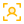
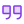

  
  <h1>Code of Conduct</h1>
  
A welcoming, harassment-free community for everyone.

  

    <a href="README.md">README</a> ·
    <a href="CONTRIBUTING.md">Contributing</a> ·
    <a href="CODE_OF_CONDUCT.md"><b>Code of Conduct</b></a> ·
    <a href="SECURITY.md">Security</a> ·
    <a href="https://shreesharma07.github.io/numsy/">Website</a>
  

---

##  Our pledge

We as members, contributors and leaders pledge to make participation in our community a harassment-free experience for everyone, regardless of age, body size, visible or invisible disability, ethnicity, sex characteristics, gender identity and expression, level of experience, education, socio-economic status, nationality, personal appearance, race, caste, color, religion, or sexual identity and orientation.

We pledge to act and interact in ways that contribute to an open, welcoming, diverse, inclusive and healthy community.

##  Our standards

|  Encouraged |  Unacceptable |
| --- | --- |
| Empathy and kindness toward others | Sexualized language or imagery, or unwelcome advances |
| Respect for differing opinions and experiences | Trolling, insults, and personal or political attacks |
| Giving and gracefully accepting constructive feedback | Public or private harassment |
| Owning mistakes, apologising, and learning from them | Publishing others' private information without consent |
| Focusing on what's best for the whole community | Any conduct inappropriate in a professional setting |

##  Responsibilities & scope

Community leaders clarify and enforce these standards. They may remove, edit or reject comments, commits, code, issues and other contributions that don't align with this Code, and will explain moderation decisions when appropriate.

The Code applies in all community spaces, and whenever someone officially represents the community in public: using an official address or account, or acting as a representative at an event.

##  Reporting

Report unacceptable behaviour **privately** to the maintainer, [Shri Kumar Sharma](https://github.com/shreesharma07), via [shrikumarsharma.in](https://shrikumarsharma.in) or [LinkedIn](https://www.linkedin.com/in/shreesharma07/). Please don't use public issues. Every report is reviewed promptly and fairly, and reporters' privacy and security are respected.

##  Enforcement guidelines

| Level | Community impact | Consequence |
| :-: | --- | --- |
| **1 · Correction** | Inappropriate language or other unprofessional or unwelcome behaviour | Private written warning explaining the violation; a public apology may be requested |
| **2 · Warning** | A single incident or a series of actions | Warning plus no interaction with the people involved for a set period; further violations may lead to a ban |
| **3 · Temporary ban** | Serious or sustained inappropriate behaviour | Temporary ban from all community interaction and communication |
| **4 · Permanent ban** | A pattern of violations, harassment, or aggression toward groups | Permanent ban from all public community interaction |

##  Attribution

Adapted from the [Contributor Covenant](https://www.contributor-covenant.org), [version 2.1](https://www.contributor-covenant.org/version/2/1/code_of_conduct.html). The enforcement ladder was inspired by [Mozilla's code of conduct enforcement ladder](https://github.com/mozilla/diversity). See the [FAQ](https://www.contributor-covenant.org/faq) and [translations](https://www.contributor-covenant.org/translations).

---

   
  Built by <a href="https://shrikumarsharma.in">Shri Kumar Sharma</a> with <a href="https://claude.com/claude-code">Claude Code</a> · <a href="https://github.com/shreesharma07">GitHub</a> · <a href="https://www.linkedin.com/in/shreesharma07/">LinkedIn</a>

