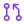

<div align="center">
  
  <h1>Contributing to Numsy</h1>
  <p>Bug reports, fixes, docs and ideas are all welcome. Here's how to make them land smoothly.</p>
  <p>
    <a href="README.md">README</a> ·
    <a href="CONTRIBUTING.md"><b>Contributing</b></a> ·
    <a href="CODE_OF_CONDUCT.md">Code of Conduct</a> ·
    <a href="SECURITY.md">Security</a> ·
    <a href="https://numsy.pages.dev/">Website</a>
  </p>
</div>

---

##  Ways to contribute

| | You want to… | Do this |
| :-: | --- | --- |
|  | Report a bug | [Open an issue](https://github.com/shreesharma07/numsy/issues/new) with version, OS, the command or code you ran, expected vs. actual output |
|  | Suggest a feature | Open an issue describing the *problem* before writing code |
|  | Improve docs | Send a PR directly. Typos and examples are always welcome |
|  | Fix an issue | Comment on it first so work isn't duplicated |
|  | Report a vulnerability | **Don't open an issue.** Follow [SECURITY.md](SECURITY.md) |

> [!IMPORTANT]
> Never paste real people's phone numbers into issues, tests or fixtures. Use fake ones like `9876501234`.

##  Setup

Requires **Node.js 24** (≥ 22.22 for the dev tooling) and **pnpm 12**. Maintainer docs (architecture, CI/CD, releasing) live in [`docs/maintainers`](docs/README.md#maintaining-numsy).

```bash
git clone https://github.com/shreesharma07/numsy.git && cd numsy
pnpm install
pnpm validate        # Biome + type-check + tests (the same gate CI runs)
```

| Command | Purpose |
| --- | --- |
| `pnpm build` | Compile `src/` → `dist/` and the dashboard → `dist/dashboard` |
| `pnpm cli -- validate 9876501234` | Run the CLI from source |
| `pnpm serve` | Start the local dashboard + REST API on port 6789 |
| `pnpm test` · `pnpm test:cov` | Jest, optionally with coverage |
| `pnpm test:ui` | Playwright on the local dashboard and the website playground |
| `pnpm check` | Biome lint + format, with fixes applied |
| `pnpm --filter @numsy/website dev` | Run the docs website locally |

##  Project layout

```text
src/engine     browser-safe engine shared by every surface (numsy/engine)
src/cli        numsy CLI · terminal output · dashboard server launcher
src/core       Numsy facade · Parser · PhoneValidator · FileProcessor
src/common     pure functions · helpers · interfaces · types
src/controllers, src/services   NestJS server: dashboard API + legacy upload
public/        REST API and health pages served by `numsy dashboard`
test/          Jest specs
e2e/           Playwright specs for both dashboards
website/       website (Cloudflare Pages) and the shared dashboard UI (website/src/dashboard)
assets/        brand assets and doc icons
```

##  Code style

[Biome](https://biomejs.dev) formats and lints everything, and the pre-commit hook runs it on staged files.

- Give public APIs explicit types, and avoid `any` in new code.
- Keep `src/engine` and `src/common/functions` free of Node.js imports; I/O belongs in `core/` or `cli/`.
- Test files with synthetic data only. Never commit real phone numbers or contact lists.
- Give every exported symbol a short JSDoc comment.
- Naming: `PascalCase` for classes and types, `camelCase` for functions and variables, `UPPER_SNAKE_CASE` for constants.

##  Tests

- **Fixes** need a test that fails without the fix.
- **Features** need happy-path and main error-path tests.
- **CLI** behaviour is tested in-process through `run()` in `test/cli.spec.ts`.

##  Commits & pull requests

Commits follow [Conventional Commits](https://www.conventionalcommits.org); they drive versioning and the changelog.

```text
feat(cli): add --only unique option
fix(parser): read hyperlink cells in xlsx files
docs: clarify country-code formatting
```

| Type | Releases | Use for |
| --- | :-: | --- |
| `feat` | minor | New capability |
| `fix` · `perf` · `refactor` · `docs` | patch | Bug fixes, speed-ups, restructuring, published docs |
| `chore` · `ci` · `test` · `style` | none | Tooling, pipelines, tests, formatting |

Breaking change? Add a `BREAKING CHANGE:` footer, which triggers a major release.

1. Fork, then branch off `main`: `feat/…` or `fix/…`
2. Make the change, add tests, and run `pnpm validate`
3. Open a focused PR that explains **what** and **why**, and links the issue

##  Releases

Merges to `main` run CI. Then [semantic-release](https://semantic-release.gitbook.io) publishes to npm, tags the release and updates [CHANGELOG.md](CHANGELOG.md). Never bump versions by hand.

##  Questions

Ask in [issues](https://github.com/shreesharma07/numsy/issues) or reach the maintainer via [shrikumarsharma.in](https://shrikumarsharma.in).

---

<p align="center">
  <br />
  <sub>Built by <a href="https://shrikumarsharma.in">Shri Kumar Sharma</a> with <a href="https://claude.com/claude-code">Claude Code</a> · <a href="https://github.com/shreesharma07">GitHub</a> · <a href="https://www.linkedin.com/in/shreesharma07/">LinkedIn</a></sub>
</p>
