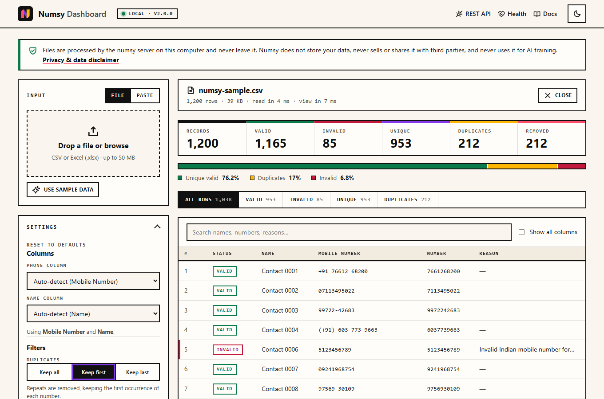

<p align="center">
  <a href="https://numsy.pages.dev/">
    <picture>
      <source media="(prefers-color-scheme: dark)" srcset="assets/brand/numsy-banner-dark.svg" />
      
    </picture>
  </a>
</p>

<p align="center">
  <a href="https://www.npmjs.com/package/numsy"></a>
  <a href="https://www.npmjs.com/package/numsy"></a>
  <a href="https://www.npmjs.com/package/numsy"></a>
  <a href="https://www.npmjs.com/package/numsy"></a>
  <a href="https://packagephobia.com/result?p=numsy"></a>
  <a href="LICENSE"></a>
  <br />
  <a href="https://github.com/shreesharma07/numsy/releases"></a>
  <a href="https://github.com/shreesharma07/numsy/stargazers"></a>
  <a href="https://github.com/shreesharma07/numsy/commits/main"></a>
  <a href="https://github.com/shreesharma07/numsy/graphs/contributors"></a>
  <a href="https://github.com/shreesharma07/numsy/issues"></a>
  <br />
  <a href="https://codecov.io/gh/shreesharma07/numsy"></a>
  <a href="https://github.com/shreesharma07/numsy/actions/workflows/main.yml"></a>
  <a href="https://badge.socket.dev/npm/package/numsy/2.1.0"></a>
  <a href="#local-dashboard"></a>
  <a href="#privacy"></a>
  <a href="#built-with-claude"></a>
</p>

<p align="center">
  <a href="https://numsy.pages.dev/"><b>Website</b></a> ·
  <a href="https://numsy.pages.dev/playground/">Playground</a> ·
  <a href="docs/README.md">Docs</a> ·
  <a href="CONTRIBUTING.md">Contributing</a> ·
  <a href="SECURITY.md">Security</a> ·
  <a href="CHANGELOG.md">Changelog</a>
</p>

**Numsy** validates, sanitizes, extracts and de-duplicates Indian mobile numbers from text, CSV and Excel. Use it as a typed TypeScript library, a CLI, a local dashboard on `localhost:6789`, or the [playground](https://numsy.pages.dev/playground/) in your browser. One engine powers all four, so they always agree.

##  Install

```bash
npm install numsy@latest        # library
npm install -g numsy@latest     # CLI → numsy
npx numsy@latest --help         # or run it without installing
```

> [!NOTE]
> Numsy moved from `@numsy/numsy` to `numsy` in 2.1.0. Replace the old package with `npm i numsy@latest`; the API is the same.

##  Quick start

```bash
numsy validate 9876501234 "+91 98765 43210"
numsy process contacts.xlsx -f json,csv,xlsx -d reports
numsy process leads.csv --dedupe --only valid --columns numbers --header-name Mobile -o clean.csv
numsy dashboard --open          # http://localhost:6789
```

```ts
import { Numsy } from 'numsy';

const numsy = new Numsy({ enableLogging: false });
numsy.validate('+91 98765 01234'); // → { sanitized: '9876501234', isValid: true, … }

const report = await numsy.analyzeFile('contacts.xlsx', { dedupe: 'first' });
report.analytics; // → { totalValidNumbers, uniqueValidNumbers, duplicatesRemoved, … }
```

##  Local dashboard

`numsy dashboard` opens a dashboard on [`http://localhost:6789`](http://localhost:6789). Drop in a CSV or Excel file (up to 50 MB) or paste text, tune the filters, browse the results and export exactly the rows you need.

<p align="center">
  <picture>
    <source media="(prefers-color-scheme: dark)" srcset="assets/screens/dashboard-dark.png" />
    
  </picture>
</p>

| Area | Options | CLI equivalent |
| --- | --- | --- |
| Filters | Keep all, first or last duplicate · reject dummy numbers · first number per cell · skip empty cells | `--dedupe` `--keep` `--loose` `--first-only` `--skip-empty` |
| Columns | Auto-detected phone and name columns, or your choice | `--column` `--name-column` |
| Rows | All · Valid · Invalid · Unique · Duplicates, with search and paging | `--only` |
| Output | `9876501234` · `+919876501234` · `+91 98765 01234` · name + number only · custom number header · header row on or off · max rows | `--number-style` `--columns` `--header-name` `--no-header` `--max-rows` |
| Export | CSV · Excel · JSON · Markdown · Text | `-f csv,xlsx,json,md,txt` |

It runs on your machine only: it listens on `127.0.0.1`, keeps uploads in memory and makes no requests to the internet. The same dashboard runs in the [website playground](https://numsy.pages.dev/playground/), where a Web Worker does the work inside your browser tab. The server also exposes a [REST API](docs/guides/rest-api.md) for scripts.

##  Performance

| Workload | Time |
| --- | --- |
| Validate 100,000 numbers | **89 ms** (about 1.1 million per second) |
| Validate 1,000,000 numbers | **0.82 s** |
| Analyse + de-duplicate 500,000 rows | **1.8 s** |
| Real 11.7 MB Excel export, 505,277 rows | read in 8.7 s, analysed in 2.2 s |

Measured on an AMD Ryzen 7 laptop with Node.js 24. See [Performance](docs/guides/performance.md) for the method, the full tables and how to run `node scripts/benchmark.js` yourself.

##  Privacy

Numsy never receives your data. The library, CLI and local dashboard run on your computer; the playground runs in your browser. Numsy **does not store** file contents, **never sells or shares** them with third parties, and **never uses them for AI training**. Read the [privacy & data disclaimer](https://numsy.pages.dev/privacy/).

##  Documentation

| | |
| --- | --- |
| **Website** | [Getting started](https://numsy.pages.dev/docs/) · [CLI](https://numsy.pages.dev/docs/cli/) · [API](https://numsy.pages.dev/docs/api/) · [Local dashboard](https://numsy.pages.dev/docs/web-ui/) · [Formats](https://numsy.pages.dev/docs/formats/) · [FAQ](https://numsy.pages.dev/docs/faq/) |
| **Try it** | [Playground](https://numsy.pages.dev/playground/): upload, filter and export in your browser; nothing is uploaded |
| **In this repo** | [`docs/`](docs/README.md): [CLI](docs/guides/cli.md) · [Library](docs/guides/library.md) · [Dashboard & REST API](docs/guides/rest-api.md) · [Performance](docs/guides/performance.md) |

##  Community

Contributions are welcome. Start with [CONTRIBUTING.md](CONTRIBUTING.md), follow the [Code of Conduct](CODE_OF_CONDUCT.md), and report vulnerabilities privately as described in [SECURITY.md](SECURITY.md).

<p>
  <a href="https://github.com/shreesharma07/numsy/graphs/contributors">
    
  </a>
</p>

##  Built with Claude

<table>
  <tr>
    <td>
      <h3>Vibe-coded with Claude ✨</h3>
      <p>
        Numsy 2.x was built in collaboration with
        <a href="https://claude.ai"><b>Claude</b></a>, Anthropic's AI, through
        <a href="https://claude.com/claude-code"><b>Claude Code</b></a>. That covers the <code>numsy</code> CLI,
        the shared engine, the local dashboard and playground, the exporters, the tests, these docs,
        the brand identity and the website.
      </p>
      <p>
        Shri Kumar Sharma set the direction, made the product calls and owns the result.
        Claude wrote the code, tests and docs alongside him.
      </p>
      <p>
        <a href="https://claude.com/claude-code">Try Claude Code →</a>
      </p>
    </td>
  </tr>
</table>

##  License

[MIT](LICENSE) © [Shri Kumar Sharma](https://shrikumarsharma.in)

---

<p align="center">
  <br />
  <sub>Built by <a href="https://shrikumarsharma.in">Shri Kumar Sharma</a> with <a href="https://claude.com/claude-code">Claude Code</a> · <a href="https://github.com/shreesharma07">GitHub</a> · <a href="https://www.linkedin.com/in/shreesharma07/">LinkedIn</a><br />Website hosted and deployed on <a href="https://pages.cloudflare.com">Cloudflare Pages</a> · Coverage by <a href="https://codecov.io/gh/shreesharma07/numsy">Codecov</a></sub>
</p>
