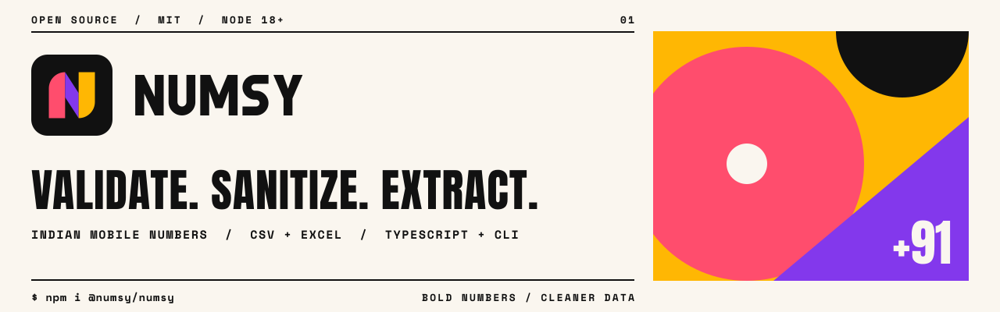

<p align="center">
  <a href="https://shreesharma07.github.io/numsy/">
    <picture>
      <source media="(prefers-color-scheme: dark)" srcset="assets/brand/numsy-banner-dark.svg" />
      
    </picture>
  </a>
</p>

<p align="center">
  <a href="https://www.npmjs.com/package/@numsy/numsy"></a>
  <a href="https://www.npmjs.com/package/@numsy/numsy"></a>
  <a href="https://github.com/shreesharma07/numsy/actions/workflows/main.yml"></a>
  <a href="https://github.com/shreesharma07/numsy/stargazers"></a>
  <a href="LICENSE"></a>
</p>

<p align="center">
  <a href="https://shreesharma07.github.io/numsy/"><b>Website</b></a> ·
  <a href="CONTRIBUTING.md">Contributing</a> ·
  <a href="CODE_OF_CONDUCT.md">Code of Conduct</a> ·
  <a href="SECURITY.md">Security</a> ·
  <a href="CHANGELOG.md">Changelog</a>
</p>

**Numsy** validates, sanitizes, extracts and de-duplicates Indian mobile numbers from text, CSV and Excel. It ships as a typed TypeScript library, a CLI and a local web UI.

##  Install

```bash
npm install @numsy/numsy        # library
npm install -g @numsy/numsy     # CLI → numsy
```

##  Quick start

```bash
numsy validate 9876501234 "+91 98765 43210"
numsy process contacts.xlsx -f json,csv,xlsx -d reports
```

```ts
import { Numsy } from '@numsy/numsy';

const numsy = new Numsy({ enableLogging: false });
numsy.validate('+91 98765 01234'); // → { sanitized: '9876501234', isValid: true, … }
```

##  Documentation

Guides, the full CLI and API reference, output formats, a browser-only playground and the FAQ live on
**[shreesharma07.github.io/numsy](https://shreesharma07.github.io/numsy/)**.

##  Community

Contributions are welcome. Start with [CONTRIBUTING.md](CONTRIBUTING.md), follow the [Code of Conduct](CODE_OF_CONDUCT.md), and report vulnerabilities privately as described in [SECURITY.md](SECURITY.md).

<p>
  <a href="https://github.com/shreesharma07/numsy/graphs/contributors">
    
  </a>
</p>

##  License

[MIT](LICENSE) © [Shri Kumar Sharma](https://shrikumarsharma.in)

---

<p align="center">
  <br />
  <sub>Built by <a href="https://shrikumarsharma.in">Shri Kumar Sharma</a> · <a href="https://github.com/shreesharma07">GitHub</a> · <a href="https://www.linkedin.com/in/shreesharma07/">LinkedIn</a></sub>
</p>
