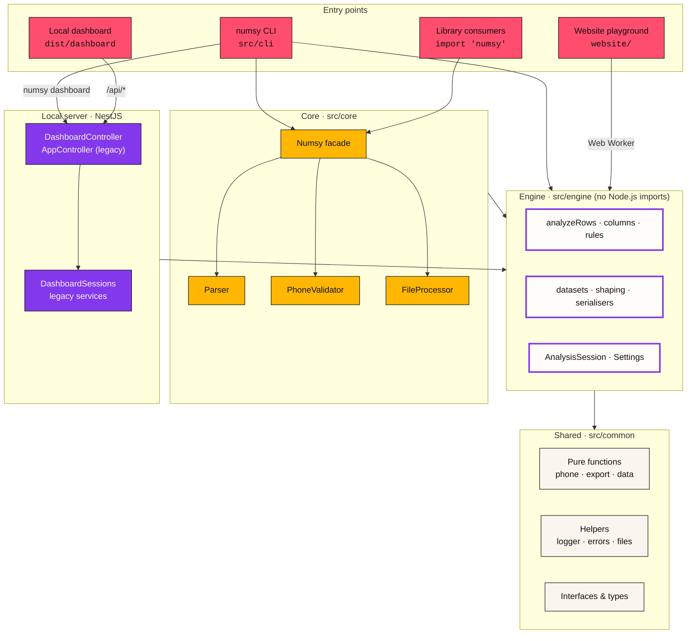
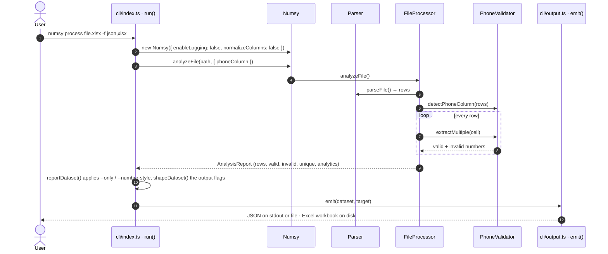
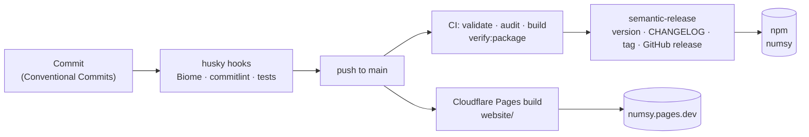

#  Architecture

[Docs](../README.md) › Maintaining Numsy › Architecture

## Layers

## Modules

| Path | Responsibility |
| --- | --- |
| `src/index.ts` | Public package surface: core classes, interfaces, functions, helpers |
| `src/core/Numsy.ts` | Facade; owns one `Parser`, `PhoneValidator`, `FileProcessor` and passes options down |
| `src/core/Parser.ts` | `parseFile()` / `parseBuffer()`: CSV via `parseCsv()`, XLSX via `exceljs` + `worksheetToRows()`, header normalisation, CSV writing |
| `src/core/PhoneValidator.ts` | Validation, extraction, phone-column detection |
| `src/core/FileProcessor.ts` | `analyze()` → `analyzeRows()`; `processFile()` → ZIP bundle |
| `src/engine/` | Browser-safe core (`numsy/engine`): rules, column detection, `analyzeRows()`, datasets, `shapeDataset()`, serialisers, `Settings`, `AnalysisSession` |
| `src/common/functions/phone.functions.ts` | Sanitising, candidate finding, final regex validation |
| `src/common/functions/export.functions.ts` | Re-exports the engine serialisers; Node-only `writeXlsx()` / `toXlsxBuffer()` |
| `src/cli/index.ts` | Argument parsing (`util.parseArgs`), commands, exit codes |
| `src/cli/output.ts` | Terminal table, colours, routing formats to stdout or files |
| `src/cli/server.ts` | `startServer()` for `numsy dashboard`: port 6789, `127.0.0.1`, host guard, `--open` |
| `src/controllers/dashboard.controller.ts` | `/api/meta`, `parse`, `text`, `view`, `export`, `analyze`, `session/:id` |
| `src/services/dashboard-sessions.service.ts` | In-memory sessions (1 h idle TTL, 8 most recent) |
| `src/controllers/app.controller.ts`, other services | Legacy `/api/upload` ZIP flow and health endpoints |
| `website/src/dashboard/` | The dashboard UI: `createLocalRuntime()` (server) or `createBrowserRuntime()` (Web Worker) |
| `website/local/` | Entry built into `dist/dashboard` by `vite.dashboard.config.ts` |

## Data flow: `numsy process file.xlsx -f json,xlsx`

## Release & delivery

## Design rules

- **Pure core.** `common/functions` has no I/O, so it's trivially testable.
- **Machine-readable CLI.** Data goes to stdout and status to stderr. Library logging is off inside the CLI.
- **Untrusted input.** CSV cells are formula-neutralised; terminal output is stripped of control characters.
- **One engine.** The CLI, the library, the local dashboard and the website playground all call `src/engine`, so they agree to the row. New behaviour belongs there first, with a test in `test/engine.spec.ts` and, for the UI, `e2e/`.
- **Browser-safe engine.** `src/engine` and the pure modules it imports must not import Node.js modules; the website type-checks and bundles them.
- **Legacy server path.** The NestJS services behind `/api/upload` pre-date the engine and keep their own processing for 1.x compatibility.
